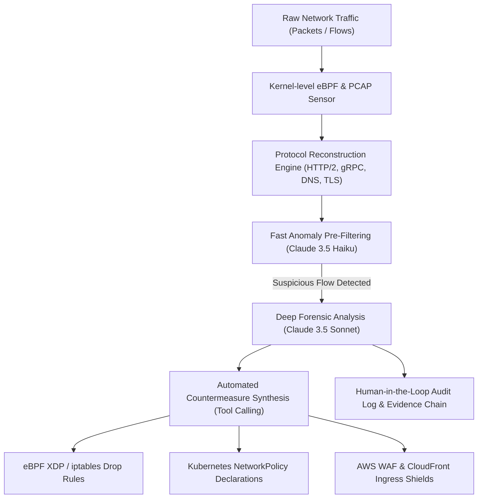

# Corpverse Technologies - Claude for Startups & Cloud Credits Application Dossier

**Entity Name:** Corpverse Technologies Private Limited (M/s VcorpTech)  
**Registered Email:** support@corpversetechnologies.com  
**Website:** https://corpversetechnologies.com  
**Founder & Technical Lead:** Rahul Kumar (Promoter / Director)  
**Institutional Backing / Incubator:** DTU Innovation and Incubation Foundation (DTU-IIF), Delhi Technological University  
**Incubation Ref:** File No. DTU-IIF/VcorpTech/83/2024-25/733 (Dated 24.02.2025)  
**Official Document:** [DTU IIF Letter of Intent](./DTU_IIF_Letter_of_Intent.jpg)  
**Target Programs:** 
1. Anthropic Claude for Startups ($1,000 - $25,000+ Credits & 1-Yr Team Plan)
2. AWS Activate Portfolio Tier via DTU-IIF ($10,000 - $100,000 Bedrock Claude Credits)

---

## 1. Company & Founder Profile

* **Company Legal Name:** Corpverse Technologies Private Limited / M/s VcorpTech
* **Corporate Email:** support@corpversetechnologies.com
* **Official Website:** https://corpversetechnologies.com
* **Founding Date:** 2024 / 2025
* **Stage:** Pre-Seed / Incubated (DTU-IIF, Delhi Technological University)
* **Founder:** Rahul Kumar
* **Founder Qualifications:**
  - MBA in Business Analytics, Delhi Technological University (2023–2025)
  - B.Tech in Information Technology, Delhi Technological University (2016–2020)
* **Technical Experience:** 4+ Years DevOps / Cloud Infrastructure / Platform Security
* **Industry Certifications:**
  - AWS Certified DevOps Engineer – Professional (DOP-C02)
  - AWS Certified Data Engineer – Associate (DEA-C01)
  - AWS Knowledge: Cloud Essentials & AI-Driven Development Lifecycle
* **Incubation Base:** DTU Innovation and Incubation Foundation (DTU-IIF), AB-04, 8th Floor, Room 805, Delhi Technological University, Shahbad Daulatpur, Delhi-110042.

---

## 2. Core Idea & Architecture: Autonomous AI Network Defense & Packet Forensics Agent

### Overview
Corpverse Technologies is developing an autonomous, agentic network security platform that combines kernel-level telemetry (eBPF and live packet capture) with Claude's advanced reasoning capabilities to detect, analyze, and autonomously mitigate complex network intrusions and zero-day threats in real time.

### Key Technical Pillars:
1. **Packet Capture & Telemetry Pipeline:**
   A lightweight edge daemon captures raw network packet streams and reconstructs protocol flows using eBPF probes without performance penalties.
2. **Claude 3.5 Haiku (Sub-Second Anomaly Triage):**
   High-frequency telemetry summaries and metadata are piped to Claude 3.5 Haiku for instant triage of anomalous payload patterns and protocol deviations.
3. **Claude 3.5 Sonnet (Deep Forensic Reconstruction):**
   Flagged PCAP sequences and application payload contexts (up to 200,000 tokens) are analyzed by Claude 3.5 Sonnet to map attacker chains (C2 beaconing, port scanning, lateral movement).
4. **Autonomous Remediation Synthesis (Tool-Calling & Rule Generation):**
   Using structured tool-calling, the agent autonomously drafts, validates, and applies non-breaking security policies:
   - Dynamic Linux `iptables` / `nftables` / eBPF XDP filters.
   - Kubernetes `NetworkPolicy` declarations to isolate compromised workloads.
   - AWS WAF and CloudFront rule sets.
5. **Explainability & Human-in-the-Loop Audit:**
   Produces forensic post-mortem reports with cryptographic packet evidence, verifying benign traffic remains unhindered.

---

## 3. Pre-Filled Form Answers for Claude for Startups

### Q: What is your company's name and website?
> **Answer:**  
> Company: Corpverse Technologies (M/s VcorpTech)  
> Website: https://corpversetechnologies.com  
> Email: support@corpversetechnologies.com

### Q: Briefly describe what your startup does (1-2 sentences).
> **Answer:**  
> Corpverse Technologies builds an autonomous AI network defense agent that captures live packet telemetry via eBPF and leverages Claude to detect zero-day security threats, analyze forensic PCAP streams, and autonomously synthesize precision firewall and network policies.

### Q: How do you plan to use the Claude API in your product?
> **Answer:**  
> We integrate Claude 3.5 Haiku for high-throughput anomaly triage of packet metadata and Claude 3.5 Sonnet for deep forensic reconstruction of multi-vector network attacks. Claude's large 200k context window allows us to feed raw protocol dumps and session traces to pinpoint zero-day exploits, while its structured tool-use directly generates and verifies dynamic kernel eBPF rules, Kubernetes NetworkPolicies, and Cloud WAF configurations to remediate vulnerabilities in real time.

### Q: What stage is your company and what funding have you raised?
> **Answer:**  
> Stage: Pre-Seed / Incubated.  
> We are officially incubated at the DTU Innovation and Incubation Foundation (DTU-IIF) promoted by Delhi Technological University (Govt. of NCT of Delhi, Letter of Intent Ref: DTU-IIF/VcorpTech/83/2024-25/733).

### Q: What Claude models are you primarily interested in using?
> **Answer:**  
> Claude 3.5 Sonnet (for forensics, threat reasoning, and policy code synthesis) and Claude 3.5 Haiku (for low-latency streaming telemetry classification).

---

## 4. Application Channels & Submission Guide

### Channel A: Direct Anthropic "Claude for Startups"
* **Application Link:** https://claude.com/programs/startups
* **Steps:**
  1. Go to https://claude.com/programs/startups on a personal laptop or non-corporate network (to bypass corporate Zscaler proxy).
  2. Sign in with `support@corpversetechnologies.com`.
  3. Submit the pre-filled responses above.

### Channel B: AWS Activate Portfolio Tier ($10,000 - $100,000 in Credits)
* **Bedrock Access:** AWS Activate promotional credits cover Anthropic Claude models on Amazon Bedrock.
* **Steps:**
  1. Request the DTU-IIF AWS Activate Provider Org ID from `dtuiif@dtu.ac.in`.
  2. Apply at https://aws.amazon.com/startups/credits under the Portfolio Tier.
  3. Attach the DTU-IIF Letter of Intent (`DTU-IIF/VcorpTech/83/2024-25/733`).
  4. Enable Amazon Bedrock in the AWS Console to run Claude models.
